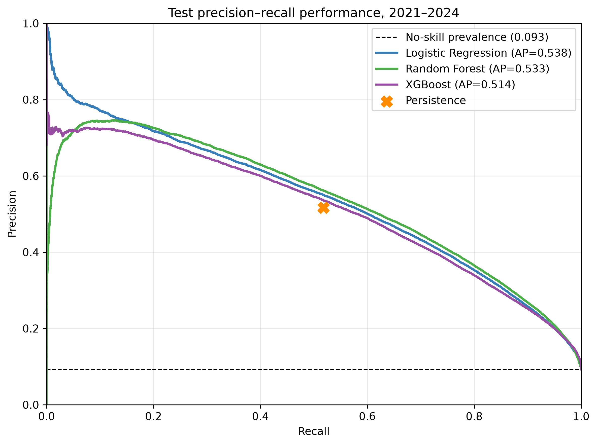

# Machine-Learning Prediction of Vegetation Drought in Ethiopia

A reproducible workflow for predicting monthly vegetation drought across Ethiopia using satellite observations, CHIRPS precipitation, and ERA5-Land reanalysis.

The model predicts drought at month `t` from hydroclimate and vegetation conditions during the previous one to three months. Vegetation drought is defined as a standardized MODIS NDVI anomaly below `-1`.

## Data

All datasets cover January 2001–December 2024 (288 months) on a common approximately 0.1° grid.

| Dataset | Variable | Units |
|---|---|---:|
| CHIRPS | Monthly precipitation | mm/month |
| ERA5-Land | 2 m air temperature | °C |
| ERA5-Land | Root-zone soil moisture | m³/m³ |
| ERA5-Land | Total evaporation | mm/month |
| MODIS MOD13A3 | NDVI | Unitless |

The data were clipped to Ethiopia and processed in Google Earth Engine before conversion from multi-band GeoTIFF to monthly NetCDF files.

## Workflow

```text
Data acquisition
    → GeoTIFF-to-NetCDF conversion
    → Monthly standardized anomalies
    → 1-, 2-, and 3-month lagged predictors
    → Chronological model training
    → Evaluation, interpretation, and mapping
```

Anomaly statistics were calculated from the training period only to prevent future information from entering preprocessing.

| Split | Period | Purpose |
|---|---|---|
| Training | 2001–2017 | Anomaly reference and model fitting |
| Validation | 2018–2020 | Threshold selection |
| Testing | 2021–2024 | Final independent evaluation |

The final models used 15 predictors: 1-, 2-, and 3-month lags of precipitation, temperature, root-zone soil moisture, evaporation, and NDVI anomalies.

## Models

- Always-no-drought baseline
- Previous-month persistence
- Logistic Regression
- Random Forest
- XGBoost

Because drought is an imbalanced class, evaluation emphasized balanced accuracy, recall, F1 score, ROC-AUC, and average precision rather than accuracy alone.

## Test results

Performance for 2021–2024:

| Method | Balanced accuracy | Precision | Recall | F1 | ROC-AUC | Average precision |
|---|---:|---:|---:|---:|---:|---:|
| Always no drought | 0.500 | 0.000 | 0.000 | 0.000 | 0.500 | 0.093 |
| Persistence | 0.734 | 0.517 | 0.518 | 0.517 | 0.734 | 0.312 |
| Logistic Regression | **0.785** | 0.473 | **0.642** | 0.545 | 0.905 | **0.538** |
| Random Forest | 0.777 | **0.504** | 0.615 | **0.554** | **0.909** | 0.533 |
| XGBoost | 0.767 | 0.492 | 0.596 | 0.539 | 0.903 | 0.514 |

Random Forest provided the best F1 score, while Logistic Regression detected the largest proportion of drought cases.



## Key findings

- Previous-month NDVI was the dominant predictor, showing strong vegetation persistence.
- Recent precipitation and root-zone soil moisture added predictive information beyond persistence.
- Random Forest improved test F1 from `0.517` for persistence to `0.554`.
- Observed and predicted drought-frequency patterns broadly agreed.
- The model overpredicted drought in parts of southern and southeastern Ethiopia.


## Repository structure

```text
data/           Raw and processed data (excluded from Git)
figures/        Final plots and spatial maps
notebooks/      Exploratory notebooks
report/         Project documentation
results/        Metrics and summary tables
src/            Data-processing and modelling scripts
```

## Reproduce the analysis

Create the environment:

```bash
conda create -n ethiopia-drought python=3.11
conda activate ethiopia-drought
pip install -r requirements.txt
```

Run the workflow:

```bash
python src/convert_geotiff_stacks_to_netcdf.py
python src/create_standardized_anomalies.py
python src/build_ml_feature_cube.py
python src/run_eda_and_baselines.py
python src/train_drought_models.py
python src/evaluate_drought_models.py
python src/map_drought_predictions.py
```

Large GeoTIFF, NetCDF, and trained-model files are excluded from Git. Source code, figures, and compact result tables are version controlled.

## Limitations

- The drought target is derived from MODIS NDVI rather than independent field observations.
- The same spatial pixels occur across chronological splits, so spatial autocorrelation remains.
- Model scores were not explicitly probability-calibrated.
- Elevation, land cover, crop type, and irrigation were not included.
- This is a retrospective prediction experiment, not an operational seasonal forecast.

## Author

**Robera Tarekegn Mosissa**  
Hydroclimate and Water Resources Researcher

## License

MIT License
