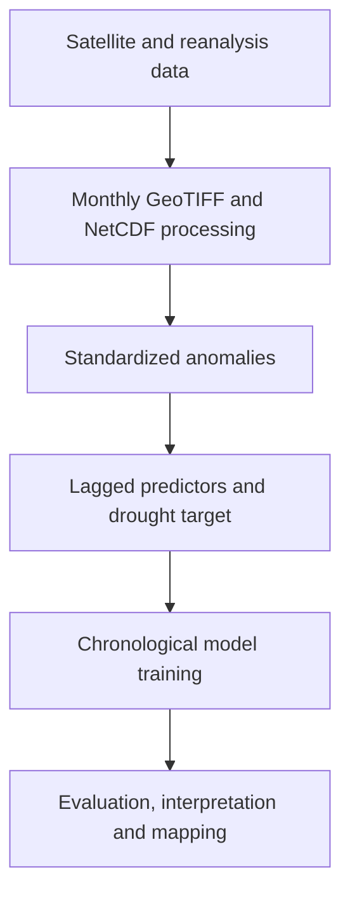
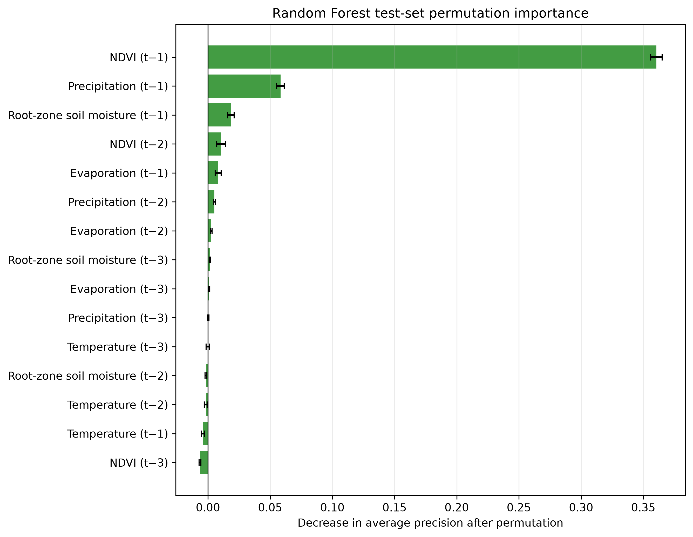
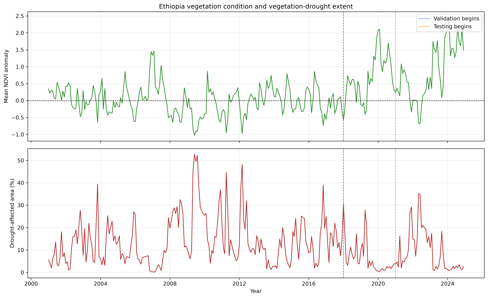
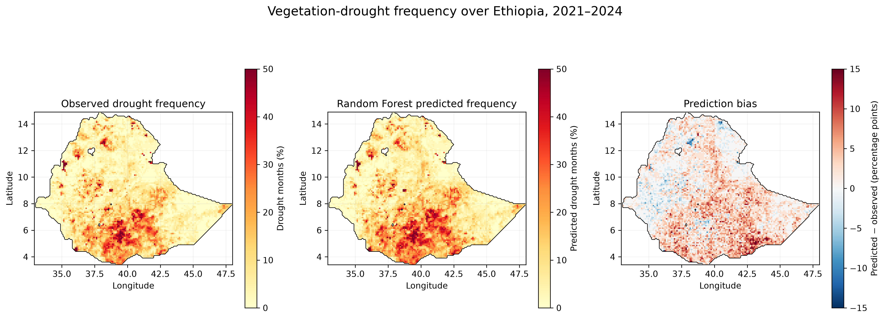
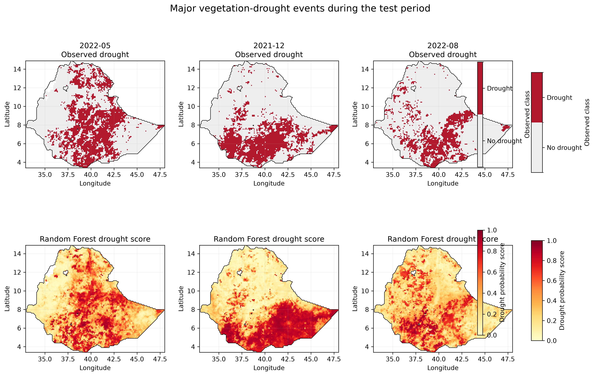

# Machine-Learning Prediction of Vegetation Drought in Ethiopia


A reproducible hydroclimate machine-learning workflow for predicting monthly vegetation drought across Ethiopia using satellite observations and ERA5-Land reanalysis data.


The project predicts vegetation drought at month \(t\) using precipitation, temperature, root-zone soil moisture, evaporation and vegetation conditions from the previous one to three months.


## Project overview


Vegetation drought affects agricultural production, ecosystems and pastoral livelihoods across Ethiopia. This project investigates whether recent hydroclimatic conditions and vegetation memory can predict monthly vegetation drought at approximately 0.1° spatial resolution.


Vegetation drought is defined as:


$$

\mathrm{Drought}_t = 1

\quad \text{when} \quad

NDVI_{z,t} < -1

$$


Here, \(NDVI_z\) is the calendar-month standardized MODIS NDVI anomaly.


## Objectives


The project aims to:


* Build a reproducible monthly hydroclimate dataset for Ethiopia.

* Calculate leakage-free standardized anomalies.

* Predict vegetation drought using lagged hydroclimate variables.

* Compare machine-learning models against simple drought baselines.

* Identify the most important drought predictors.

* Map observed and predicted vegetation-drought patterns.


## Workflow





## Study domain and period


* **Domain:** Ethiopia

* **Temporal coverage:** January 2001–December 2024

* **Number of months:** 288

* **Spatial resolution:** approximately 0.1°

* **Grid dimensions:** 115 latitude × 151 longitude cells

* **Prediction target:** monthly pixel-level vegetation drought


The approximately 45% missing fraction in the rectangular arrays primarily represents grid cells outside Ethiopia’s irregular national boundary.


## Datasets


| Dataset   | Variable                |      Units | Product                        |

| --------- | ----------------------- | ---------: | ------------------------------ |

| CHIRPS    | Monthly precipitation   | mm month⁻¹ | CHIRPS v2 pentad               |

| ERA5-Land | 2-m air temperature     |         °C | Monthly aggregated             |

| ERA5-Land | Root-zone soil moisture |     m³ m⁻³ | Depth-weighted soil layers 1–3 |

| ERA5-Land | Total evaporation       | mm month⁻¹ | Monthly aggregated             |

| MODIS     | NDVI                    |   Unitless | MOD13A3 v6.1                   |


The data were obtained and preprocessed using Google Earth Engine. Each dataset was clipped to Ethiopia, aggregated to monthly resolution and exported as a 288-band GeoTIFF stack.


### Data transformations


* CHIRPS pentad precipitation was summed to monthly totals.

* ERA5-Land temperature was converted from kelvin to degrees Celsius.

* ERA5-Land evaporation was converted to positive millimetres per month.

* MODIS NDVI was multiplied by its 0.0001 scale factor.

* MODIS observations with poor SummaryQA values were excluded.

* All five variables were aligned to the same time period and spatial grid.


Root-zone soil moisture represents approximately the upper 100 cm of soil:


$$

SM_{\mathrm{root}} =

\frac{

7SM_1 + 21SM_2 + 72SM_3

}{100}

$$


The weights represent the approximate thicknesses of ERA5-Land soil layers 1–3 in centimetres.


## Standardized anomalies


The seasonal cycle was removed by standardizing each variable separately for every calendar month:


$$

z_{m,t} =

\frac{

x_{m,t} - \mu_{m,\mathrm{train}}

}{

\sigma_{m,\mathrm{train}}

}

$$


The monthly means and standard deviations were calculated exclusively from the 2001–2017 training period.


This prevents information from the validation and test periods from entering the anomaly reference climatology.


## Chronological data split


A chronological split was used instead of a random temporal split.


| Split      | Period    | Purpose                             |

| ---------- | --------- | ----------------------------------- |

| Training   | 2001–2017 | Model fitting and anomaly reference |

| Validation | 2018–2020 | Probability-threshold selection     |

| Testing    | 2021–2024 | Final independent evaluation        |


The final feature cube contained approximately:


| Split      | Valid samples | Drought frequency |

| ---------- | ------------: | ----------------: |

| Training   |     1,906,905 |            14.16% |

| Validation |       341,505 |             6.69% |

| Testing    |       455,223 |             9.28% |


A reproducible stratified sample of 400,000 training observations was used for model fitting. All valid validation and test observations were retained for evaluation.


## Predictors


The final models use 15 predictors:


* Precipitation anomaly at \(t-1\), \(t-2\) and \(t-3\)

* Temperature anomaly at \(t-1\), \(t-2\) and \(t-3\)

* Root-zone soil-moisture anomaly at \(t-1\), \(t-2\) and \(t-3\)

* Evaporation anomaly at \(t-1\), \(t-2\) and \(t-3\)

* NDVI anomaly at \(t-1\), \(t-2\) and \(t-3\)


All predictors therefore represent conditions available before the target month.


## Baselines and machine-learning models


The following methods were evaluated:


1. Always predict no drought

2. Previous-month drought persistence

3. Logistic Regression

4. Random Forest

5. XGBoost


An initial climate-only experiment showed that previous-month persistence was a difficult baseline to beat. NDVI lags were then included to create autoregressive models combining vegetation memory with hydroclimatic information.


Class imbalance was handled using balanced class weights for Logistic Regression and Random Forest and `scale_pos_weight` for XGBoost.


Probability thresholds were selected by maximizing F1 score on the validation period. These thresholds were fixed before test evaluation.


## Evaluation metrics


Because drought is an imbalanced class, accuracy alone is not sufficient. Model evaluation emphasizes:


* Balanced accuracy

* Precision

* Recall

* F1 score

* ROC-AUC

* Average precision


Average precision is particularly useful because the no-skill reference is approximately equal to drought prevalence, which was only 9.28% during the test period.


## Test results


Final performance for January 2021–December 2024:


| Method                     | Balanced accuracy | Precision |    Recall |        F1 |   ROC-AUC | Average precision |

| -------------------------- | ----------------: | --------: | --------: | --------: | --------: | ----------------: |

| Always no drought          |             0.500 |     0.000 |     0.000 |     0.000 |     0.500 |             0.093 |

| Previous-month persistence |             0.734 |     0.517 |     0.518 |     0.517 |     0.734 |             0.312 |

| Logistic Regression        |         **0.785** |     0.473 | **0.642** |     0.545 |     0.905 |         **0.538** |

| Random Forest              |             0.777 | **0.504** |     0.615 | **0.554** | **0.909** |             0.533 |

| XGBoost                    |             0.767 |     0.492 |     0.596 |     0.539 |     0.903 |             0.514 |


Random Forest was selected as the primary balanced model because it achieved the best validation F1 score and the highest test F1 score.


Logistic Regression provides a useful high-recall alternative when detecting a larger proportion of drought events is more important than limiting false alarms.


## Improvement over persistence


The Random Forest model improved over previous-month persistence:


| Metric            | Persistence | Random Forest |

| ----------------- | ----------: | ------------: |

| Recall            |       0.518 |         0.615 |

| F1 score          |       0.517 |         0.554 |

| ROC-AUC           |       0.734 |         0.909 |

| Average precision |       0.312 |         0.533 |


This demonstrates that lagged precipitation, soil moisture, temperature and evaporation provide predictive information beyond vegetation persistence alone.


## Predictor importance


Random Forest permutation importance identified previous-month NDVI as the dominant predictor.


The five strongest predictors were:


1. NDVI anomaly at \(t-1\)

2. Precipitation anomaly at \(t-1\)

3. Root-zone soil-moisture anomaly at \(t-1\)

4. NDVI anomaly at \(t-2\)

5. Evaporation anomaly at \(t-1\)


This ranking suggests that vegetation drought is strongly persistent but is also influenced by recent water availability.


Negative or near-zero permutation importance for some longer lags indicates limited additional information after stronger and correlated predictors are included. It does not imply that those variables physically prevent drought.





## Temporal drought patterns


The Ethiopia-wide time series shows substantial variation in national vegetation conditions and drought-affected area.





The validation and test periods generally contain fewer drought observations than the training period, highlighting an important temporal distribution shift.


## Spatial results


Observed and predicted drought-frequency patterns show broad spatial agreement during 2021–2024.


The model captures elevated drought occurrence across southern and central Ethiopia. The spatial bias map indicates moderate overprediction in parts of southern and southeastern Ethiopia and localized underprediction elsewhere.





Maps of major test-period events demonstrate that the model reproduces many of the main observed drought patterns while retaining spatial uncertainty.





## Repository structure


```text

.

├── data/

│   ├── raw/

│   └── processed/

├── figures/

├── notebooks/

├── report/

├── results/

├── src/

│   ├── convert_geotiff_stacks_to_netcdf.py

│   ├── create_standardized_anomalies.py

│   ├── build_ml_feature_cube.py

│   ├── run_eda_and_baselines.py

│   ├── train_drought_models.py

│   ├── evaluate_drought_models.py

│   └── map_drought_predictions.py

├── .gitignore

├── LICENSE

├── README.md

└── requirements.txt

```


## Main output files


### Results


```text

results/

├── annual_drought_frequency.csv

├── baseline_metrics.csv

├── final_test_metrics.csv

├── model_metadata.json

├── model_metrics.csv

├── model_metrics_climate_only.csv

├── monthly_drought_climatology.csv

├── random_forest_feature_importance.csv

├── selected_drought_events.csv

└── split_class_distribution.csv

```


### Figures


```text

figures/

├── eda_monthly_ndvi_drought.png

├── major_drought_event_maps.png

├── model_precision_recall_curves.png

├── model_roc_curves.png

├── random_forest_feature_importance.png

├── spatial_drought_frequency_2021_2024.png

└── test_confusion_matrices.png

```


## Installation


Create and activate a Python environment:


```bash

conda create -n ethiopia-drought python=3.11

conda activate ethiopia-drought

pip install -r requirements.txt

```


The principal dependencies are:


* NumPy

* pandas

* xarray

* netCDF4

* rasterio

* Matplotlib

* scikit-learn

* XGBoost

* joblib


## Input data


Place the five Google Earth Engine GeoTIFF stacks in `data/raw/`:


```text

chirps_precipitation_monthly_ethiopia_2001_2024.tif

era5land_temperature_monthly_ethiopia_2001_2024.tif

era5land_rootzone_soil_moisture_monthly_ethiopia_2001_2024.tif

era5land_evaporation_monthly_ethiopia_2001_2024.tif

modis_ndvi_monthly_ethiopia_2001_2024.tif

```


Large GeoTIFF, NetCDF and trained-model files are excluded from Git.


## Reproducing the analysis


Run the scripts in this order:


```bash

python src/convert_geotiff_stacks_to_netcdf.py

python src/create_standardized_anomalies.py

python src/build_ml_feature_cube.py

python src/run_eda_and_baselines.py

python src/train_drought_models.py

python src/evaluate_drought_models.py

python src/map_drought_predictions.py

```


The pipeline performs:


1. GeoTIFF-to-NetCDF conversion

2. Coordinate and temporal validation

3. Leakage-free anomaly calculation

4. Drought-target construction

5. Lagged-feature generation

6. Chronological data splitting

7. Baseline evaluation

8. Machine-learning training

9. Threshold selection

10. Final test evaluation

11. Feature-importance analysis

12. Spatial drought mapping


## Reproducibility decisions


* Random seed: 42

* Chronological rather than random temporal splitting

* Training-only anomaly climatology

* Validation-only threshold selection

* Full validation and test evaluation

* Fixed predictor list stored in model metadata

* Large generated datasets excluded from Git

* Small result tables and figures version controlled


## Limitations


* The drought target is derived from MODIS NDVI rather than independent field observations.

* The same spatial grid cells occur in training, validation and testing, although the periods do not overlap.

* Spatial autocorrelation reduces the independence of pixel-level observations.

* The Random Forest probability scores were not explicitly calibrated.

* Elevation, land cover, crop type and irrigation information were not included.

* The fixed \(NDVI_z < -1\) threshold may not represent all local ecosystem responses equally.

* Input climate variables are observations and reanalysis products rather than operational seasonal forecasts.

* Model performance should therefore be interpreted as retrospective predictive skill, not as a deployed early-warning forecast.


## Future development


Potential extensions include:


* Spatial block cross-validation

* Independent validation using reported drought impacts

* Probability calibration

* SHAP-based interpretation

* Land-cover-specific drought models

* Inclusion of elevation, crop type and irrigation

* Comparison with SPI, SPEI and vegetation-condition indices

* Hyperparameter optimization with nested validation

* Integration of seasonal climate forecasts

* Testing transferability to neighbouring Horn of Africa countries


## Author


**Robera Tarekegn Mosissa**

Hydroclimate and Water Resources Researcher


## License


This project is distributed under the MIT License.


